<div align="center">

  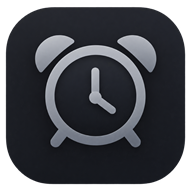

  # Lucid Alarm
  ### A Fully customizable Alarm App for Android

  <p align="center">
    <b>Deep Alarm Ringing Screen Customization • Animated Backgrounds • Custom Wallpapers</b><br/>
    <b>Alarm Groups • Multi-Select Batch Actions • Filters and Sorting • Recycle Bin</b><br/>
    <b>Stopwatch with Laps • Timer with Presets • World Clock • Interactive Live Activities (Nowbar)</b><br/>
    <b>Post-Alarm Wake Check • Upcoming Alarm Alerts • Custom Vibration Patterns • Custom Ringtones • Custom Fonts</b><br/>
    <b>HSV Color Picker • Dynamic Accent Tinting • JSON Backup and Restore</b>
  </p>

  <p align="center">
    <a href="https://github.com/DarkAspect1/Lucid-Alarm/releases"></a>
    <a href="https://developer.android.com/about/versions/12"></a>
    <a href="https://developer.android.com/jetpack/compose"></a>
  </p>

  <p align="center">
    <a href="https://github.com/DarkAspect1/Lucid-Alarm/stargazers"></a>
    <a href="https://github.com/DarkAspect1/Lucid-Alarm/commits"></a>
    <a href="https://github.com/DarkAspect1/Lucid-Alarm/issues"></a>
    <a href="LICENSE"></a>
  </p>

  <p align="center">
    <b>
      <a href="#features">Features</a> &nbsp;|&nbsp;
      <a href="#Screenshots">Screenshots</a> &nbsp;|&nbsp;
      <a href="#alarm-customization">Alarm Customization</a> &nbsp;|&nbsp;
      <a href="#nowbar-and-live-activities">Nowbar</a> &nbsp;|&nbsp;
      <a href="#stopwatch-timer-and-world-clock">StopWatch-Timer-World Clock</a> &nbsp;|&nbsp;
      <a href="#wake-check--pre-alarm-notifications-optional">Wake Check & Pre-Alarm Notifications</a> &nbsp;|&nbsp;
      <a href="#backup-and-restore">Backup and Restore</a> &nbsp;|&nbsp;
      <a href="#installation--build-requirements">Installation & Build Requirements</a> &nbsp;|&nbsp;
    </b>
  </p>

</div>

---

## Overview

Lucid Alarm is an open-source Android application built with Jetpack Compose. Designed to extend the Samsung's One UI Alarm App aesthetic, it combines borderless containers and a comprehensive visual customization engine.

Everything adapts to the user's chosen accent color including Dark Mode Wallpaper, Nowbar, and Settings

---

## Features

### Design System and UI Architecture

| Feature | Description |
| :--- | :--- |
| **Borderless Design Language** | Cards, menus, floating buttons, and pills use no outlines, reducing visual clutter across the interface. |
| **Edge Fade Masks** | Offscreen `BlendMode.DstIn` vertical alpha masks let scrollable content fade naturally at the top and bottom of the viewport. |
| **Floating Navigation Bar** | A compact, borderless navigation bar with active tab indicators. |
| **Back to Top Button** | A circular button driven by `derivedStateOf` animates into view on long lists and returns the user to the top. |
| **Floating Back Button** | When the header scrolls out of view, a circular back button floats in so you can always navigate back without scrolling up. |
| **Drag-and-drop reordering** | In selection mode, hold an alarm's selection box and drag it to a new position. Reordering only starts from the selection box, so you never move an alarm by accident.

## Screenshots

<p align="center">
  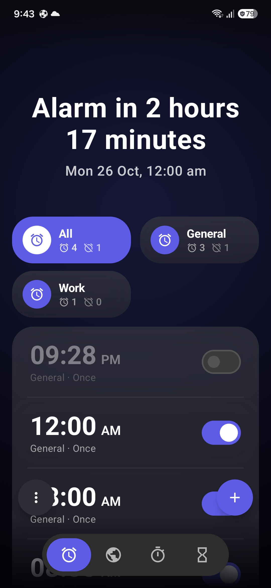
  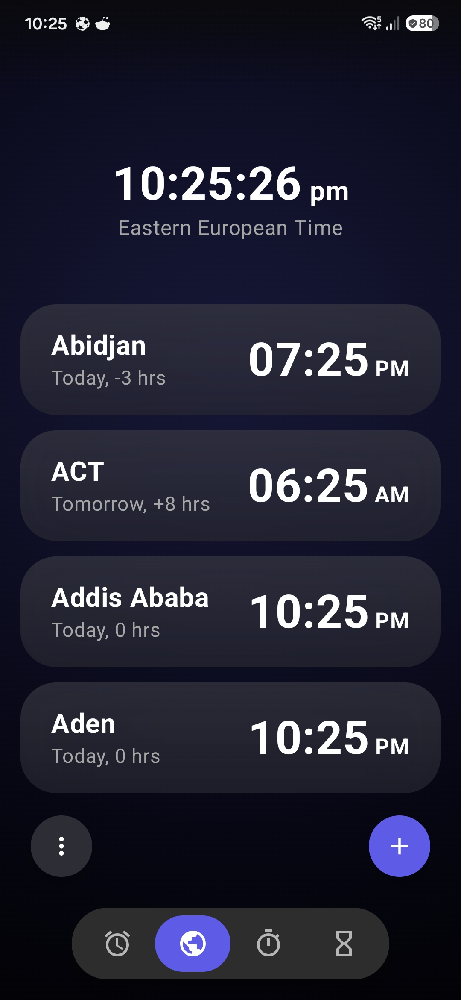
  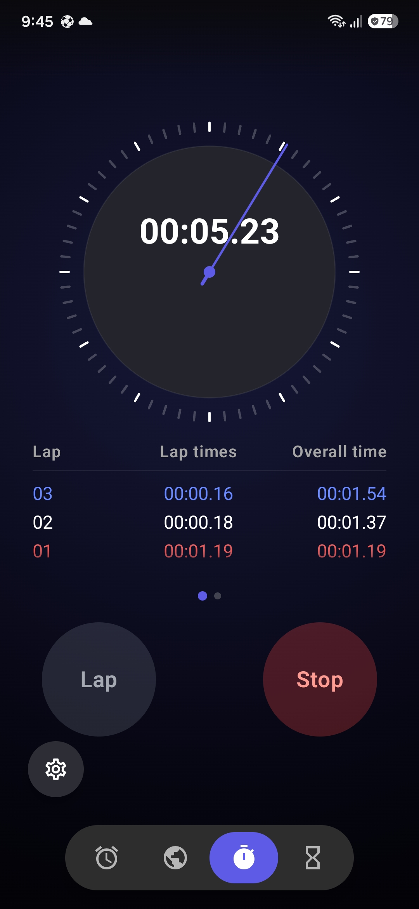
  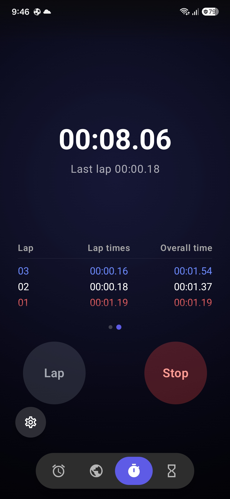
  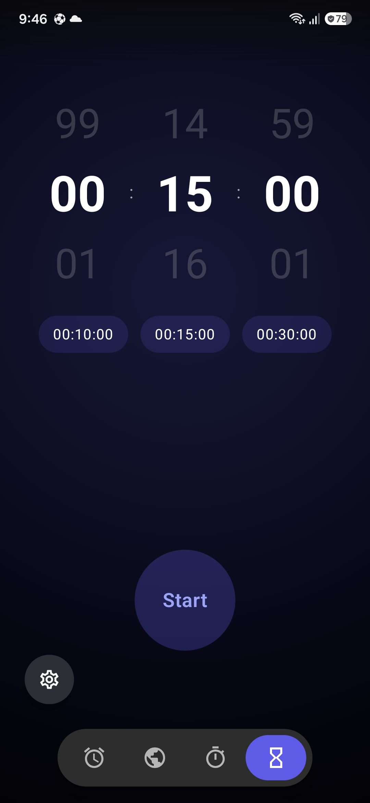
  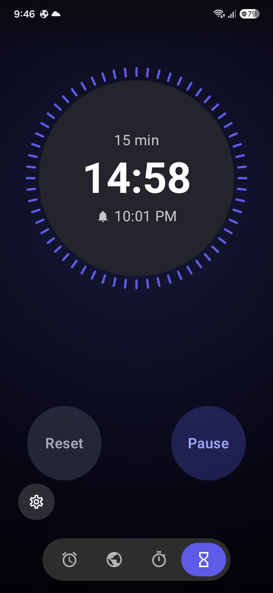
</p>

<p align="center">
  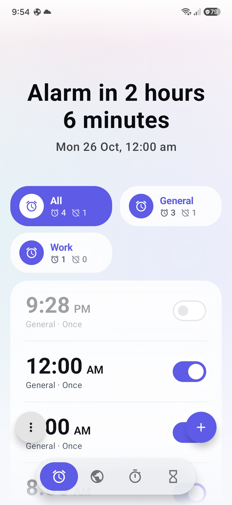
  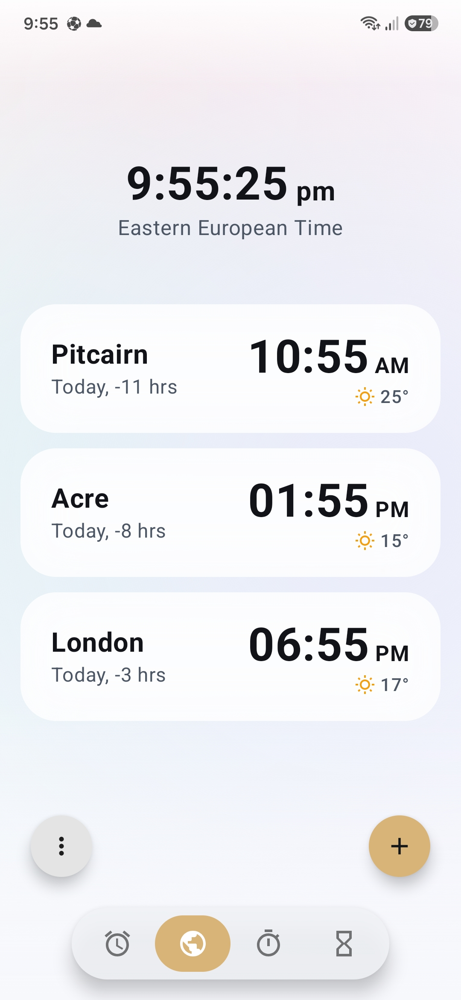
  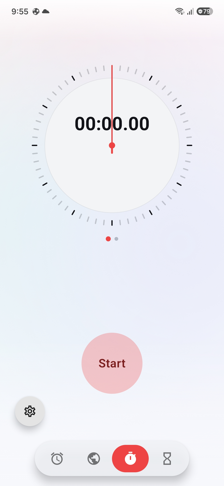
  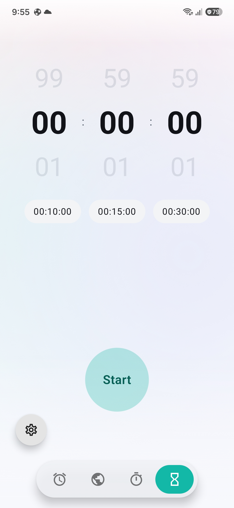
  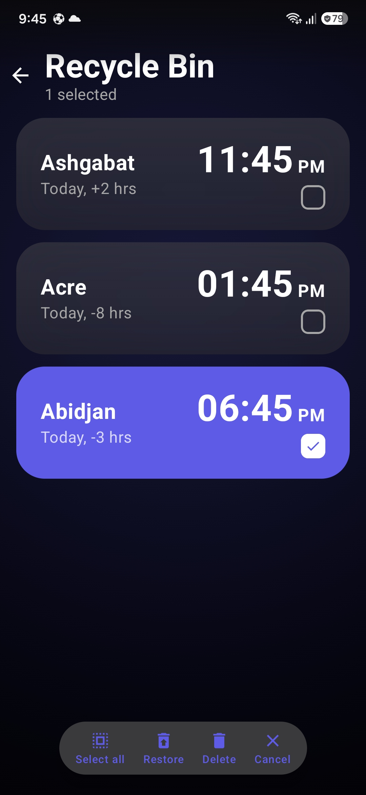
  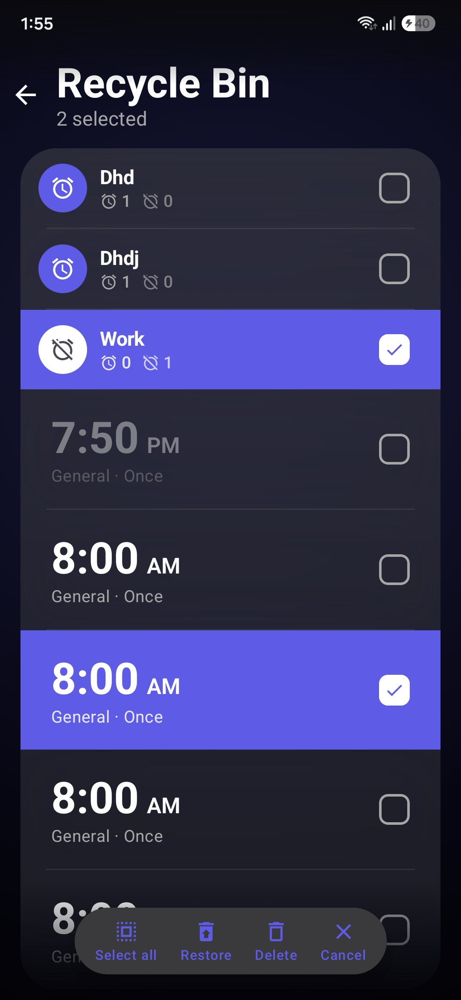
</p>

<p align="center">
  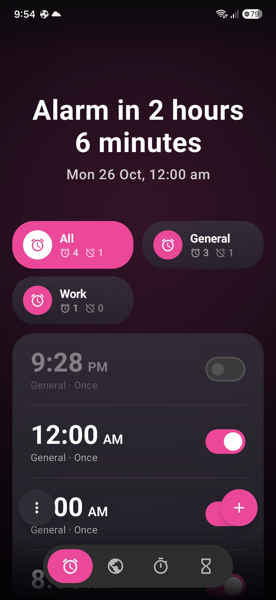
  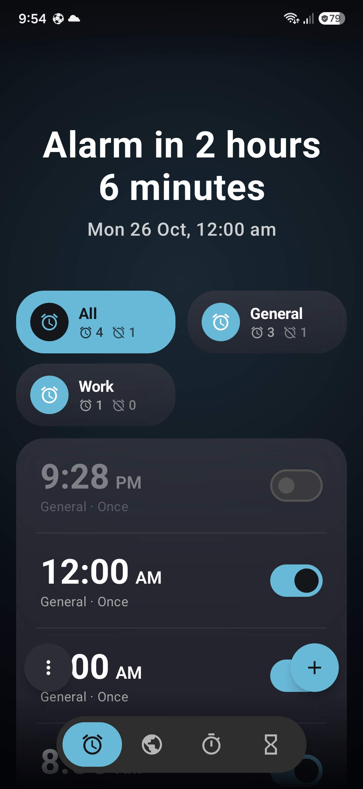
  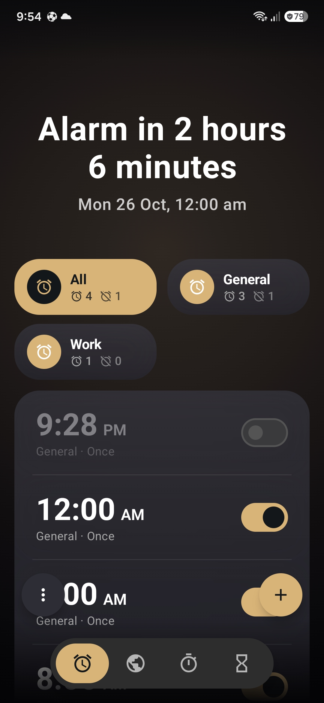
</p>

<p align="center">
  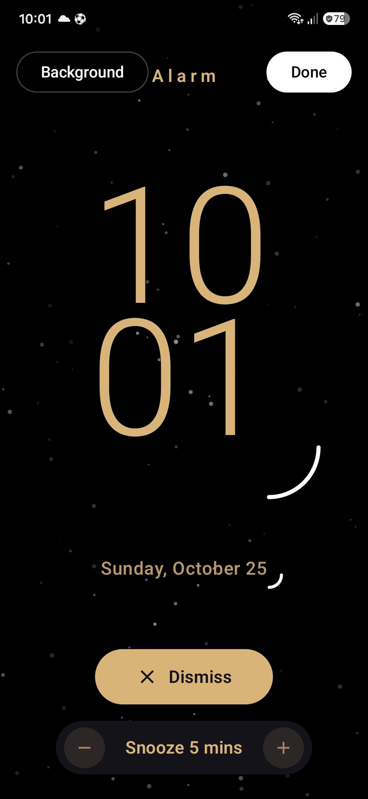
  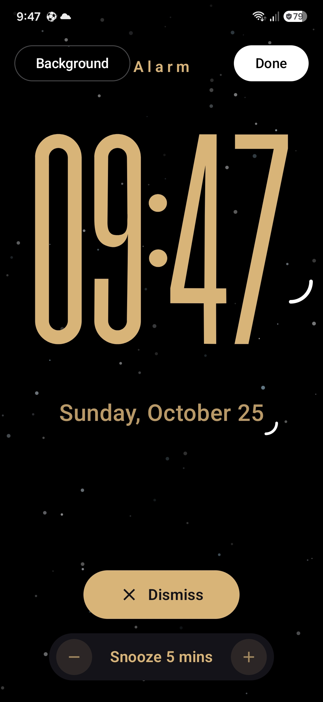
  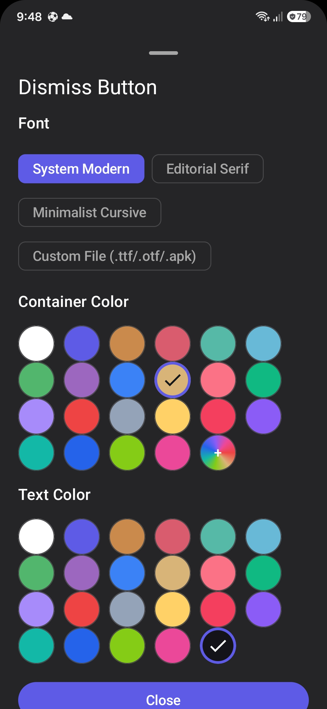
  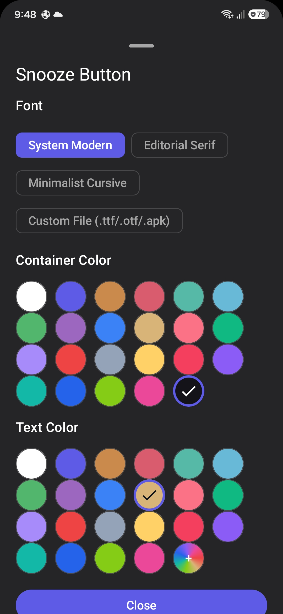
  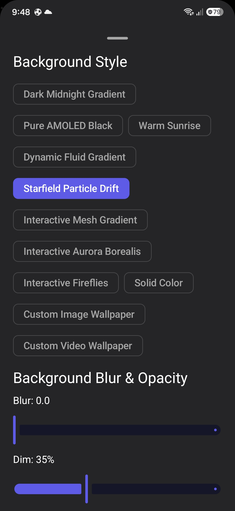
</p>

<p align="center">
  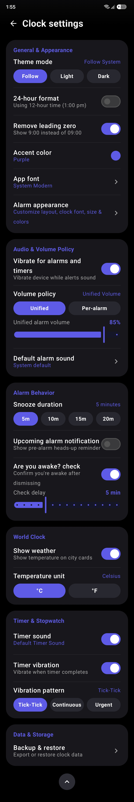
  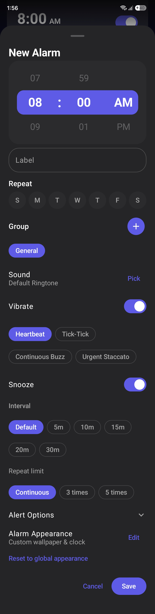
  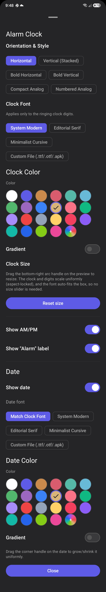
</p>

### Selection and Organization

* **Multi-select batch actions:** Long-press any alarm or world clock card to enter selection mode, with the following actions available:
  * Select all / deselect all
  * Move to group
  * Duplicate
  * Toggle on or off
  * Move to recycle bin
* **Two-column alarm groups:** Groups render in a two-column grid (`groups.chunked(2)`) with live alarm counts, outline status icons (`Alarm` / `AlarmOff`), and bulk group switches.
* **Filtering and sorting:**
  * Status filter: All, Turned On, or Turned Off
  * Day filter: Restrict alarms to specific days of the week
  * Sort order: Alarm Time, Alarm Day, or drag-and-drop Custom Order
* **Recycle bin:** A two-stage deletion workflow supporting individual restore, bulk restore, and permanent deletion.

---

## Alarm Customization

The capability of Lucid Clock is its alarm personalization engine, configurable globally or per alarm.

### Clock Layouts and Canvas Scaling

* **Six selectable layouts:**
  * Horizontal
  * Vertical Stacked
  * Bold Horizontal
  * Bold Vertical
  * Compact Analog
  * Numbered Analog

### Interactive Background Engine

* **Built-in ambient styles:**
  * Dark Midnight Gradient and Pure AMOLED Black
  * Warm Sunrise and Dynamic Fluid Gradient
  * Starfield Particle Drift (physics-based particle layers)
  * Interactive Mesh Gradient and Interactive Aurora Borealis
  * Interactive Fireflies and Solid Color Palette
* **Custom media:**
  * Custom image wallpaper loader
  * Looping, muted custom video wallpaper (`.mp4`, `.mkv`) with hardware decoding
* **Dimming & Blur control**

### Coloring and Element Control

* **Color selection:** A 24-preset curated grid, or a full HSV spectrum with hex input (`#RRGGBB`).
* **Color and gradient options for:**
  * Clock
  * Date display
  * Dismiss button (container and label)
  * Snooze button (container and label)
* **Custom font support:** Load any `.ttf`, `.otf`, or `.apk` font file from device storage.
* **Display controls:** Independent visibility toggles for the date, AM/PM indicator, and alarm label.
* **Reset Button:** Moved or resized the clock or date too far? One tap returns both to their default position and size.

---

## Nowbar and Live Activities

* **Floating heads-up pill:** Real-time countdown and stopwatch counters rendered on the Nowbar.
* **Accent color adaptation:** The Nowbar automatically adopts the app’s accent color, so the floating pill and its controls always match your chosen theme.
* **In-place controls without launching the app:**
  * Stopwatch: Lap, Stop, resume, or cancel
  * Timer: Pause, Resume, and Cancel
* **Multi-instance stacking:** The stopwatch and timer can run simultaneously in stacked floating capsules.

---

## Stopwatch, Timer, and World Clock

| Component | Key Capabilities |
| :--- | :--- |
| **Stopwatch** | Dual-mode horizontal pager with analog dial and minimal digital views with a Three-column lap table highlighting the fastest (blue) and slowest (red) laps |
| **Timer** | Three-column wheel picker (HH:MM:SS) with 10, 15, and 30 minute presets<br/>Circular progress ring with a bell indicator and completion time<br/>Automatic leading-zero removal (for example, `53s`, `1:07m`, `1:05:09h`) |
| **World Clock** | Centered clock with live seconds and full timezone descriptor<br/>City cards with relative time offsets<br/>Real-time search across the global timezone database |

---

## Wake Check & Pre-Alarm Notifications [Optional]

* **Featured Wake Check:** After an alarm is dismissed, a configurable delay (1 to 15 minutes) triggers a confirmation notification with a countdown to respond, and if it goes unanswered the alarm rings again at maximum volume and awake check notification keeps repeating until you tap “I’m Awake” in the notification, which ends the check.
* **Upcoming alarm alerts:** Dismiss or modify an upcoming alarm directly from its notification, with configurable lead times from 15 to 60 minutes.
* **Audio and haptics:** Unified or per-alarm volume override, custom ringtone selection, and distinct vibration patterns.

---

## Backup and Restore

Configurations can be exported and restored at any time using a structured JSON schema, that includes: Alarms, World Clocks, Recycle Bin, and Settings/Appearance

```json
{
  "version": 2,
  "exportedAt": "2026-10-25T01:57:00Z",
  "appSettings": {
    "themeMode": "DARK",
    "accentColor": "#D9B478",
    "removeLeadingZero": true,
    "appFont": "System Modern"
  },
  "alarms": [
    {
      "id": 1,
      "time": "08:00",
      "days": ["MON", "TUE", "WED", "THU", "FRI"],
      "groupName": "University",
      "isEnabled": true,
      "awakeCheckDelayMinutes": 5,
      "appearance": {
        "layout": "VERTICAL_STACKED",
        "clockColor": "#D9B478",
        "backgroundStyle": "STARFIELD_DRIFT"
      }
    }
  ],
  "worldClockCities": ["London", "California", "Tokyo"],
  "recycleBin": []
}
```

---

| Area | Implementation |
| :--- | :--- |
| **UI framework** | 100% Jetpack Compose built on Material 3 base |
| **State management** | Kotlin Coroutines, StateFlow, and Jetpack ViewModel |
| **Persistence** | Room (alarms, recycle bin, groups) and Jetpack DataStore (preferences) |
| **Minification** | R8 and ProGuard rules protecting Room entities and JSON serialization models |

---

## Installation & Build Requirements

* Android Studio Ladybug or Meerkat, or newer
* JDK 17 or newer
* Android SDK 34 or newer
