

  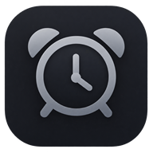

  # Lucid Alarm
  ### A Fully Customizable Alarm App

  

    <b>Deep Ringing Screen Customization • Animated Backgrounds • Custom Wallpapers and Fonts</b> 
    <b>Multi-Week Scheduling • Wake Check • Multi Timers • Nowbar • World Clock • Widgets</b> 
    <b>Alarm Groups • Recycle Bin • Seven Languages • JSON Backup and Restore</b>
  

  

    
    
    
  

  

    
    
    
    
    
  

  

    <b>
      <a href="#gallery-preview">Gallery</a> &nbsp;|&nbsp;
      <a href="#features">Features</a> &nbsp;|&nbsp;
      <a href="#alarm-customization">Alarm Customization</a> &nbsp;|&nbsp;
      <a href="#selection-and-organization">Organization</a>
    </b>
  

---

## Overview

Lucid Alarm is open-source Android alarm app inspired by One UI clock app. The idea is simple: customize everything without limits, i hated that i couldnt even change the clock font, so i made this.

---

## Gallery Preview

  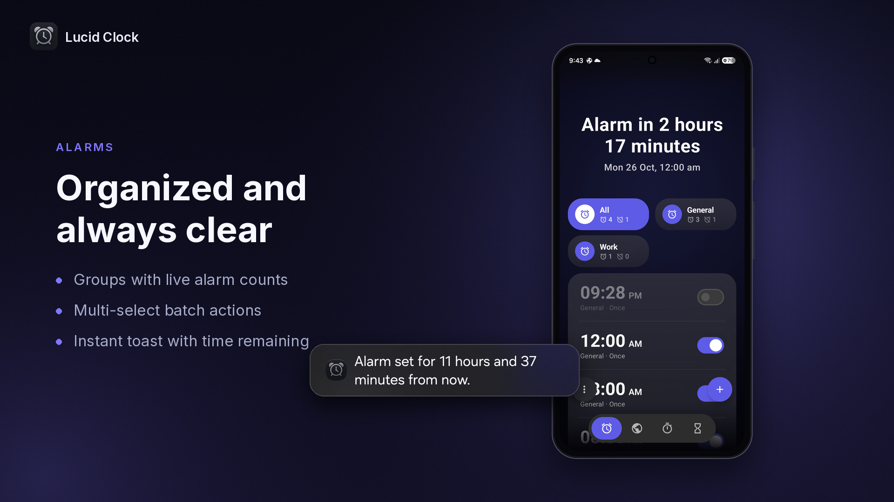
  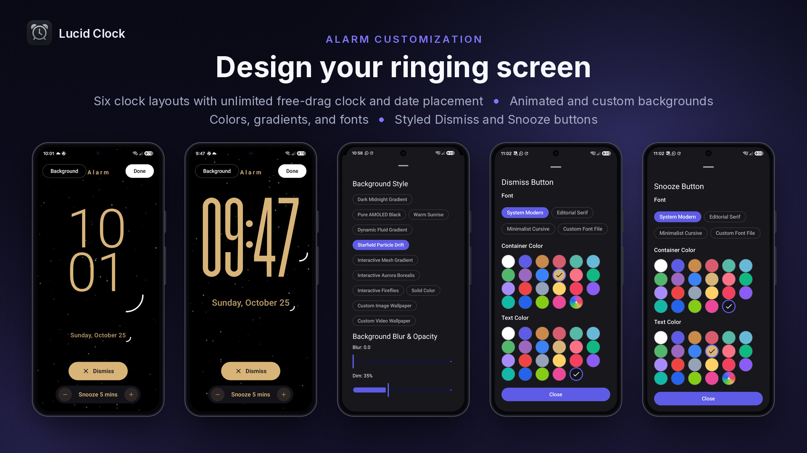
  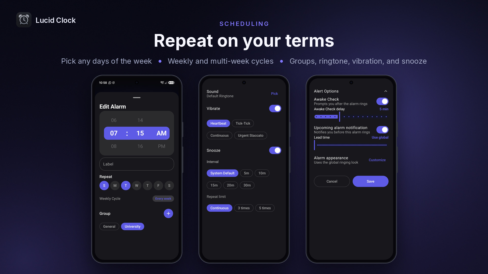
  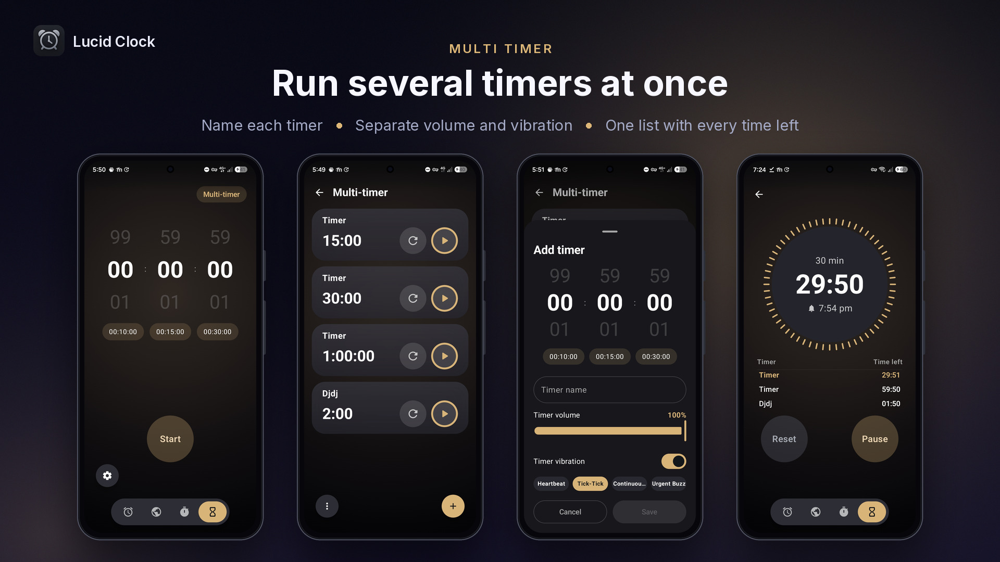
  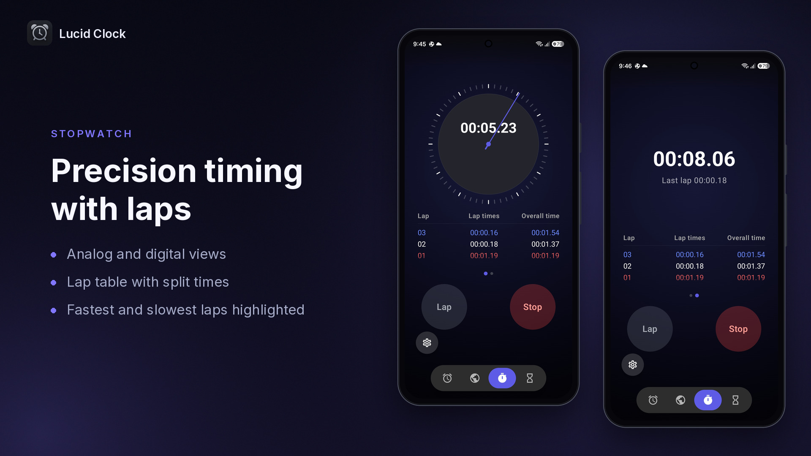
  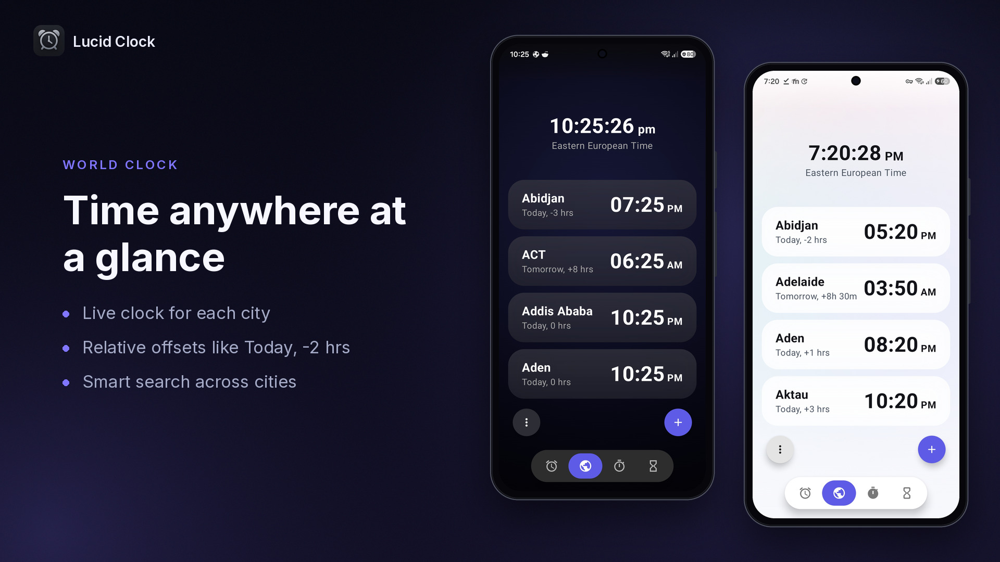
  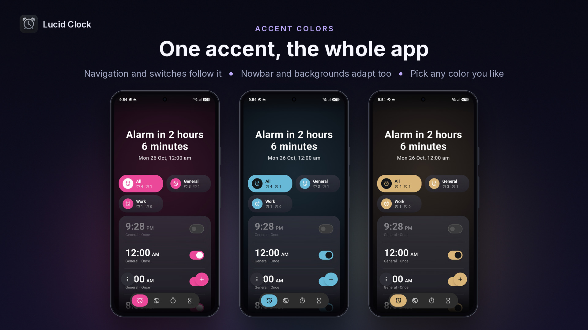
  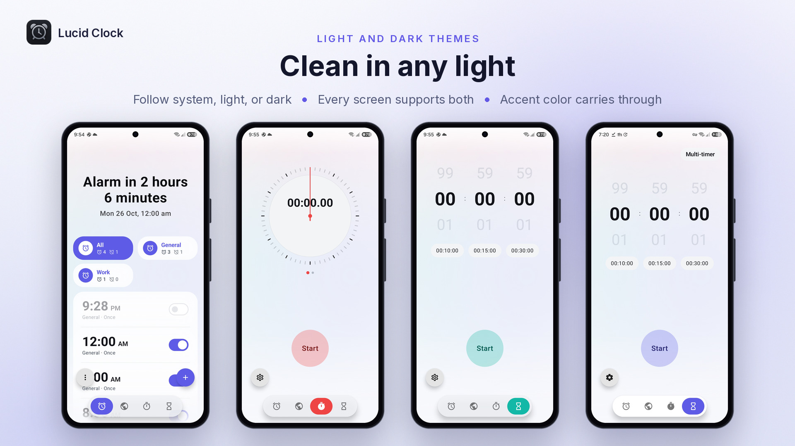
  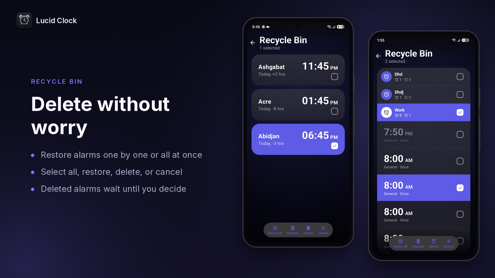
  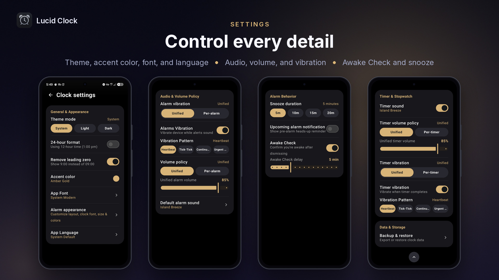

---

## Features

| Feature | What it does |
| :--- | :--- |
| **Ringing screen customization** | Clock layouts, animated or custom backgrounds, any color or gradient, custom fonts, styled Dismiss and Snooze buttons, and a clock and date you can drag and resize. Set it globally or per alarm. |
| **Wake check** | After you dismiss an alarm, a notification asks you to confirm you're awake after set amount of time, If you ignore it, the alarm rings again at full volume, it'll keep looping until you tap "I'm Awake" in the notification. The delay is configurable from 1 to 15 minutes. |
| **Multi-week scheduling** | Repeat an alarm every 2 weeks, every 3 weeks, or any number of weeks you like, and choose whether the cycle starts this week or next time. |
| **Multi timers** | Run several timers at once. Each has its controls. |
| **Nowbar** | Live stopwatch and timer pills with all controls. |
| **Accent color theming** | Choose your accent color and everything adapts to it. |
| **Widgets** | Alarm, Timer, Stopwatch, Worldclock, and a fully customizable clock widget: layouts, colors, gradients, and fonts with date and am/pm switches. Free Resize and Dragging. |
| **Groups and recycle bin** | Organize alarms into groups, and deleted alarms go to recycle bin. |
| **Upcoming alarm alerts** | Get a notification 1 to 60 minutes before an alarm, and dismiss or edit it from the notification. |
| **Alarm set toast** | Turn on or create an alarm and a toast tells you how much time is left until it rings. |
| **Sound and vibration** | Use one volume/vibration for everything or set it per alarm/timer, pick custom ringtones, and choose from several vibration patterns. |
| **World clock smart search** | Search cities with partial or approximate spelling. The closest match appears first. |
| **Seven languages** | English, Arabic, Turkish, Italian, Spanish, French, and German, with full right-to-left support for Arabic. |
| **Smooth interface** | Borderless cards and menus, faded edges on top and bottom, rounded corners, and floating back and back-to-top button. |
| **Backup & Restore** | Export and import your alarms, world clocks, recycle bin, and settings any time as a JSON file.

---

## Alarm Customization

Everything can be set globally or per alarm.

* **Clock layouts:** Horizontal, Vertical Stacked, Bold Horizontal, Bold Vertical, Compact Analog, and Numbered Analog.
* **Backgrounds:** static, solid color, animated, or custom picture/video with adjustable dimming and blur.
* **Colors:** Pick from presets or full custom HEX colors (`#RRGGBB`). Colors and gradients work on clock, date, Dismiss and Snooze buttons.
* **Fonts:** Load any `.ttf`, `.otf`, or `.apk` font file from your device.
* **Display toggles:** Show or hide the date, AM/PM indicator, and alarm label.
* **Reset button:** Moved the clock or date too far? One tap resets to their defaults.

---

## Selection and Organization

* **Multi-select:** Long-press an alarm or world clock card to select several at once. You can select all, move to a group, duplicate, toggle on/off, or delete.
* **Drag and drop:** Hold an alarm's selection box to move it. Reordering only starts from the selection box.
* **Filters and sorting:** Filter by status (all, on, off) or by day of the week, and sort by time, day, or your own custom order.

### Stopwatch, Timer, and World Clock

* **Stopwatch:** Analog and digital views, with a lap table that highlights the fastest lap in blue and the slowest in red.
* **Timer:** Wheel picker with presets, and a progress ring that shows completion time.
* **World clock:** Live time and full timezone on top.
